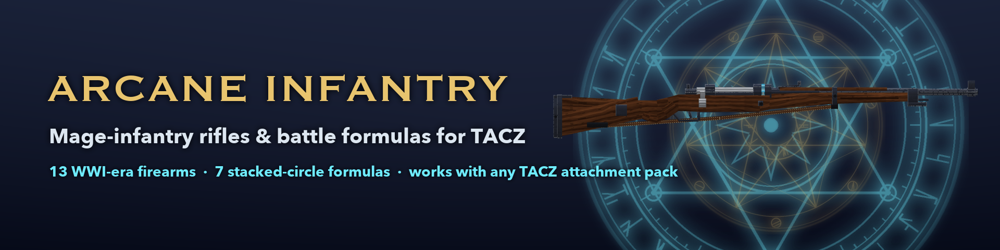
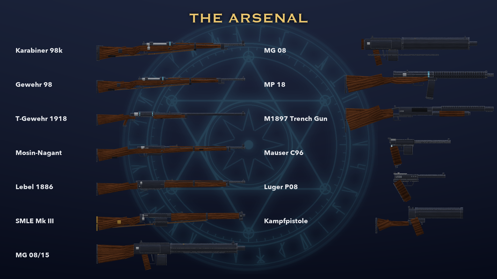

# Arcane Infantry

**Mage-infantry rifles and battle formulas for [TACZ](https://www.curseforge.com/minecraft/mc-mods/timeless-and-classics-zero).**

Thirteen WWI-era firearms, rebuilt block by block, and a formula-casting system that stacks glowing magic circles in front of your muzzle. The longer you charge, the more circles stack and the bigger they grow, up to a six-ring **Annihilation** that opens three giant circles over your target and brings down a pillar of light.

> Requires **TACZ 1.1.6+** on **Minecraft 1.20.1 / Forge 47+**. This is an add-on: it does nothing without TACZ.

---

## ✦ Formulas

Hold **G** with any gun to charge, press **V** to pick the formula, then fire. Each circle that stacks is one charge stage.

| Formula | Circles | Effect |
|---|:---:|---|
| **Explosion** | 1 | The round detonates on impact |
| **Penetration** | 2 | ×1.6 damage, ignores more armour, stronger headshots |
| **Defensive Shell** | 2 | A dome of circles that absorbs 80% of incoming damage for 10 s |
| **Barrage** | 3 | Seven magic bolts in a fan |
| **Area Suppression** | 4 | A giant circle unfolds on the ground where the round lands, then everything inside is blasted |
| **Artillery** | 5 | An arcing artillery shell with a heavy blast |
| **Annihilation** | 6 | Spends all your mana: three sky circles stack above the target, a pillar of light, then a ring of explosions and lightning |

Circles are drawn for every player, so your squad sees the cast coming. Mana regenerates over time, and every cost, charge time, radius and damage value is configurable.

---

## ✦ The Arsenal

| Faction | Firearms |
|---|---|
| **Empire** | Karabiner 98k · Gewehr 98 · Mauser 1918 T-Gewehr · Mauser C96 · Luger P08 · MP 18 · MG 08/15 · MG 08 · Kampfpistole |
| **Federation** | Mosin-Nagant M1891 |
| **Republic** | Lebel Mle 1886 |
| **Commonwealth** | SMLE Mk III Lee-Enfield |
| **Trenches** | Winchester M1897 Trench Gun |

- Damage is calibrated against TACZ's own guns by cartridge: a 7.92 mm Mauser round hits like TACZ's .30-06, the 13.2 mm T-Gewehr just under its .50 BMG.
- Every gun uses TACZ's own animations: bolts cycle, the Enfield swaps box magazines, and the Kampfpistole breaks open.
- New cartridges: 7.92×57 mm Mauser, 13.2 mm TuF, 8×50 mmR Lebel and .303 British. The C96, Luger, MP 18, Mosin and M1897 use TACZ's own ammunition.

---

## ✦ Works with your other TACZ packs

The guns accept attachments through TACZ's shared attachment tags, so **scopes, sights, suppressors, muzzle devices, grips, lasers and ammo mods from any TACZ add-on fit automatically**, not just TACZ's own.

---

## ✦ Controls

| Key | Action |
|---|---|
| **G** (hold) | Charge the selected formula |
| **V** | Cycle formulas |
| Fire | Release a fully charged formula |

Both keys can be rebound under *Controls → Arcane Infantry*.

---

## ✦ Config

`config/youjoarms-common.toml`: mana pool and regeneration, plus each formula's mana cost, charge time, radius and damage, and whether explosions break blocks (off by default).

---

*Unofficial fan-made mod inspired by mage-infantry anime. Not affiliated with or endorsed by the original authors or publishers.*
